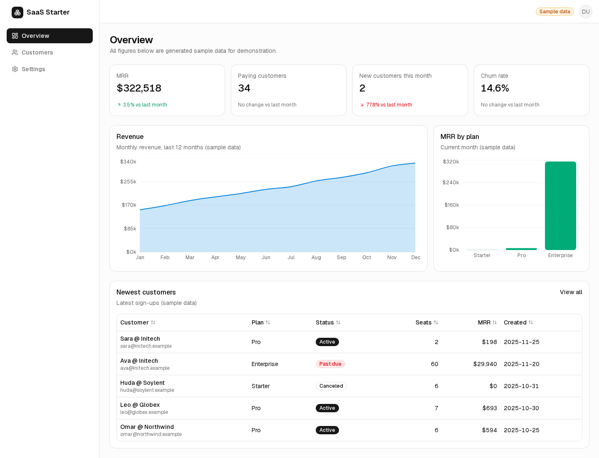
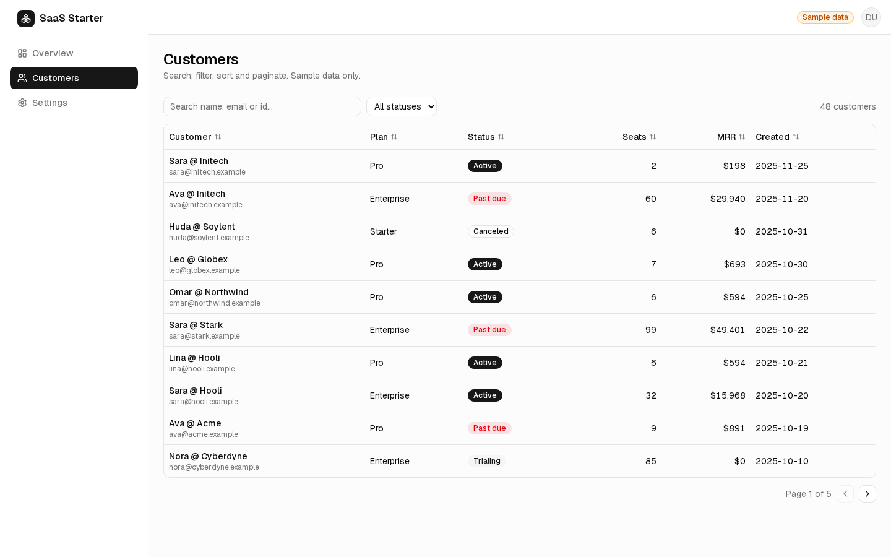
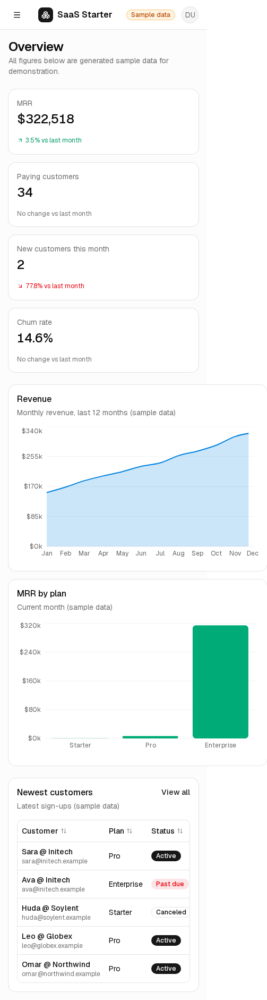

# Next.js SaaS Dashboard Starter

[](https://github.com/AhmedElbashier/nextjs-saas-dashboard-starter/actions/workflows/ci.yml)


A clean admin-dashboard starting point for SaaS products, built with **Next.js 15 (App Router)**,
**TypeScript**, **Tailwind CSS v4** and **shadcn/ui** (Base UI primitives) with **Recharts**.

> **All numbers, names and companies shown are generated sample data** (fixed-seed generator in
> `src/lib/sample-data.ts`). They are labelled "Sample data" in the UI and do not represent any real business.



| Customers table | Mobile |
|---|---|
|  |  |

## What's inside

- **Auth-ready layout**: sidebar + top bar + user menu + mobile drawer. The layout only depends on
  `getSession()` (`src/lib/auth.ts`), and `src/middleware.ts` guards `/dashboard/*` once you set
  `AUTH_REQUIRED=true`. Plug in Auth.js, Clerk, Supabase Auth or Cognito without touching pages.
- **KPI cards** and **charts** (area + bar) using shadcn's chart wrapper around Recharts.
- **Customers data table**: search, status filter, column sorting and pagination. The logic is a pure
  function (`queryCustomers`) so it is unit-tested and easy to move server-side.
- **Login** and **Settings** screens (UI only).
- **Quality gates**: ESLint, `tsc --noEmit`, Vitest unit tests, Playwright end-to-end tests, GitHub Actions CI.

## Project structure

```
src/
  app/
    (dashboard)/layout.tsx          sidebar shell, session check
    (dashboard)/dashboard/          overview, customers, settings pages
    login/page.tsx
  components/
    dashboard/                      KPI cards, charts, data table, nav, user menu
    ui/                             shadcn/ui components
  lib/
    sample-data.ts                  deterministic SAMPLE data (replace with your API)
    table.ts                        filter / sort / paginate (pure, tested)
    auth.ts                         getSession() integration point
  middleware.ts                     optional route guard
tests/unit/                         Vitest
tests/e2e/                          Playwright
scripts/screenshots.mjs             regenerates the README screenshots
```

## Getting started

```bash
npm install
npm run dev            # http://localhost:3000 -> redirects to /dashboard
```

| Script | |
|---|---|
| `npm run lint` | ESLint (next/core-web-vitals + TypeScript) |
| `npm run typecheck` | `tsc --noEmit` |
| `npm test` | Vitest unit tests |
| `npm run build` | production build |
| `npm run test:e2e` | Playwright (starts `npm start`; run `npm run build` first) |
| `npm run screenshots` | refresh `docs/screenshots/*` against a running server |

## Connecting real data

1. Replace `getDashboardData()` / `generateCustomers()` calls in the pages with fetches to your API
   (Server Components can `await` directly).
2. For large tables, move `queryCustomers` into a route handler or SQL query and pass `search`,
   `status`, `sort` and `page` as URL search params.
3. Implement `getSession()` and set `AUTH_REQUIRED=true`.

## License

MIT © Ahmed Elbashier
